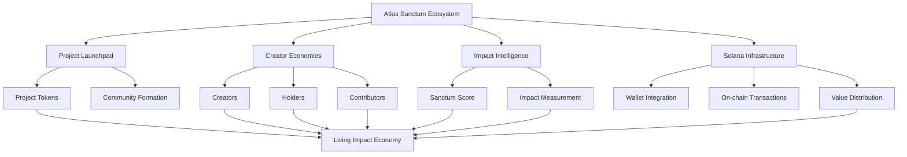

# 🏛️ Atlas Sanctum

### Living Creator Economies. Powered by Impact.

**Atlas Sanctum** is an impact-driven creator economy ecosystem built on Solana, designed to transform how creators, communities, contributors, and planet-positive initiatives create, distribute, and share value.

Launch a token. Grow your Sanctum Score. Build a living economy where value flows to the people and causes creating meaningful impact.

  <a href="https://id-preview--ddc0e2a8-0282-453d-a1f6-7e32b254ec71.lovable.app/">
    <strong>Explore Atlas Sanctum</strong>
  </a>
  &nbsp;•&nbsp;
  <a href="https://id-preview--ddc0e2a8-0282-453d-a1f6-7e32b254ec71.lovable.app/launch">
    <strong>Launch a Project</strong>
  </a>
  &nbsp;•&nbsp;
  <a href="https://id-preview--ddc0e2a8-0282-453d-a1f6-7e32b254ec71.lovable.app/dashboard">
    <strong>Dashboard</strong>
  </a>

---

## 🌍 The Vision

The internet has created an unprecedented generation of creators, innovators, artists, educators, and changemakers. Yet the economic systems supporting them remain fragmented, extractive, and disconnected from real-world impact.

Atlas Sanctum proposes a different model.

We envision an ecosystem where:

- Creators own and monetize their intellectual and creative contributions.
- Communities participate in the economic growth of the projects they support.
- Contributors receive recognition and rewards for meaningful participation.
- Environmental and social impact becomes an integral part of economic activity.
- On-chain transparency enables verifiable value distribution.
- Reputation evolves through measurable contributions rather than popularity alone.

**Our mission is to build an economy where creativity creates value, value creates impact, and impact sustains the future.**

## ✨ Core Features

### 🚀 1. Tokenized Project Launchpad

Launch community-driven projects with dedicated Solana-based tokens.

Each project establishes its own ecosystem, bringing together creators, holders, contributors, and supporters.

Key capabilities:
- Project creation and discovery.
- Token-based community economies.
- Project-specific identity and categorization.
- Creator and contributor participation.
- Impact-driven project positioning.

### 🏆 2. Sanctum Score

A living reputation mechanism designed to recognize creators and projects based on their evolving contributions and impact.

Rather than relying exclusively on follower counts or speculative popularity, Sanctum Score introduces an impact-oriented approach to ecosystem reputation.

Potential evaluation dimensions include:
- Creative contributions.
- Community participation.
- Environmental impact.
- Educational value.
- Social contributions.
- Ecosystem growth.

Scores are intended to become meaningful indicators of long-term contribution.

### 💎 3. Intelligent Value Distribution

Atlas Sanctum is designed around a value-sharing economy.

Project-generated value can be distributed across four fundamental stakeholder groups:

| Stakeholder | Purpose |
|---|---|
| Creators | Reward creative ownership and production |
| Token Holders | Recognize ecosystem participation |
| Contributors | Reward meaningful contributions |
| Planet | Support environmental and sustainability initiatives |

The objective is to build transparent, programmable distribution mechanisms that align financial incentives with collective prosperity.

### 🌱 4. Impact-Driven Economies

Every project can represent a broader mission beyond financial performance.

Supported ecosystem categories include:

- Climate action and reforestation.
- Music and creative industries.
- Education and knowledge sharing.
- Generative art and digital culture.
- Environmental conservation.
- Community development.

### 🔗 5. Solana Integration

Atlas Sanctum is being developed around the Solana ecosystem.

Solana provides the blockchain foundation for exploring:
- Tokenized project economies.
- On-chain transactions.
- Transparent value distribution.
- Wallet connectivity.
- Decentralized ecosystem participation.

**Current network:** Solana Devnet.

### 📊 6. Living Ecosystem Dashboard

The dashboard provides an overview of project activity and ecosystem growth, including:

- Active projects.
- Total transaction volume.
- Impact events.
- Creator participation.
- Sanctum Score rankings.
- Featured projects.

### 👛 7. Web3 Wallet Integration

Users can connect their wallets to interact with the Atlas Sanctum ecosystem.

The platform includes dedicated wallet and project interaction experiences.

---

## 🏗️ Ecosystem Architecture

Atlas Sanctum is organized around interconnected economic and impact layers.

## 🧭 Featured Ecosystem Projects

Atlas Sanctum demonstrates how different industries can establish their own impact-driven economies.

### 🌳 Foresta DAO

**Token:** `$FRST`  
**Category:** Climate  
**Sanctum Score:** 91

An environmental initiative focused on on-chain reforestation and verified satellite-based impact data.

[Explore Foresta DAO](https://id-preview--ddc0e2a8-0282-453d-a1f6-7e32b254ec71.lovable.app/project/foresta)

### 🎵 Lyra Nova

**Token:** `$MUSICX`  
**Category:** Music  
**Sanctum Score:** 82

A tokenized independent music ecosystem designed to reward listeners, creators, and contributors.

[Explore Lyra Nova](https://id-preview--ddc0e2a8-0282-453d-a1f6-7e32b254ec71.lovable.app/project/musicx)

### 📚 Scholar Net

**Token:** `$EDU`  
**Category:** Education  
**Sanctum Score:** 74

A decentralized learning ecosystem focused on rewarding students, educators, and knowledge contributors.

[Explore Scholar Net](https://id-preview--ddc0e2a8-0282-453d-a1f6-7e32b254ec71.lovable.app/project/scholar)

### 🎨 Lumen Studio

**Token:** `$LUMEN`  
**Category:** Digital Art  
**Sanctum Score:** 68

A generative art collective exploring shared royalties and collaborative creative economies.

[Explore Lumen Studio](https://id-preview--ddc0e2a8-0282-453d-a1f6-7e32b254ec71.lovable.app/project/lumen)

---

## 📈 Ecosystem Overview

The current platform preview displays the following dashboard metrics:

| Metric | Displayed Value |
|---|---:|
| Active Projects | 4 |
| Total Volume | $12.4M |
| Impact Events | 98K |
| Creators Onboarded | 1,830 |

*These figures represent the displayed platform preview and should not be interpreted as independently verified on-chain statistics.*

---

## 🛠️ Technology & Infrastructure

### Blockchain Layer
- Solana
- Solana Devnet
- Tokenized project economies
- Wallet connectivity

### Core Protocol Concepts
- Creator ownership
- Programmable value distribution
- On-chain transparency
- Impact-oriented reputation
- Community-driven economic participation

### Development Status

**Sanctum v1 — Live on Solana Devnet**

The current experience provides project discovery, token-launch interfaces, ecosystem dashboards, project profiles, and wallet experiences.

Smart contract implementation details, deployment addresses, security audits, and production infrastructure documentation will be published as they become available.

---

## 🗺️ Roadmap

Atlas Sanctum's long-term development direction:

- [x] Initial platform experience.
- [x] Project discovery and featured projects.
- [x] Sanctum Score leaderboard experience.
- [x] Project launch interface.
- [x] Ecosystem dashboard.
- [x] Solana Devnet positioning.
- [ ] Production-grade token launch infrastructure.
- [ ] Transparent, programmable revenue distribution.
- [ ] Verifiable impact measurement integrations.
- [ ] Expanded creator and contributor reputation systems.
- [ ] Community governance mechanisms.
- [ ] Mainnet deployment and ecosystem expansion.

*Roadmap items beyond the current platform experience represent development objectives, not confirmed releases.*

---

## 🌐 Why Atlas Sanctum?

Traditional creator economies often concentrate value in centralized platforms.

Atlas Sanctum explores an alternative:

| Traditional Creator Economy | Atlas Sanctum Vision |
|---|---|
| Platform-controlled monetization | Community-oriented value creation |
| Popularity-driven recognition | Impact-oriented reputation |
| Fragmented creator ownership | Tokenized project ecosystems |
| Opaque economic distribution | Transparent on-chain mechanisms |
| Limited environmental alignment | Integrated planetary impact |

Our ambition is not simply to tokenize creativity.

It is to create infrastructure for a new generation of regenerative digital economies.

---

## 🤝 Contributing

We believe the next generation of creator economies should be built collaboratively.

Developers, researchers, artists, founders, sustainability innovators, and blockchain enthusiasts are encouraged to contribute to the Atlas Sanctum vision.

Potential contribution areas include:

- Solana smart contract development.
- Token economics and incentive design.
- Reputation and impact measurement.
- Frontend and backend engineering.
- Blockchain analytics.
- Environmental verification systems.
- Community governance.

Contribution guidelines and development setup instructions will be published alongside the repository's implementation documentation.

---

## 🔐 Security & Responsible Development

Security, transparency, and responsible token economics are fundamental to Atlas Sanctum.

We aim to establish:
- Secure wallet interactions.
- Auditable smart contracts.
- Transparent project allocations.
- Verifiable impact reporting.
- Responsible token-launch mechanisms.
- Clear separation between reputation scores and financial promises.

The current Devnet experience is experimental. Devnet tokens are not mainnet assets and should not be treated as investments or as having guaranteed monetary value.

---

## 📜 License

The repository license has not yet been specified.

A license should be selected and added before establishing the project's public contribution and redistribution terms.

---

## 🏛️ Atlas Sanctum

**Build value. Reward impact. Regenerate the future.**

We are building toward a world where creators are empowered, communities share prosperity, and technology becomes an instrument for planetary progress.

**The future of creativity is collective. The future of value is impact-driven.**

  <strong>ATLAS SANCTUM</strong> 
  <em>Living Creator Economies. Powered by Impact.</em>

🌍 Explore: https://id-preview--ddc0e2a8-0282-453d-a1f6-7e32b254ec71.lovable.app/
